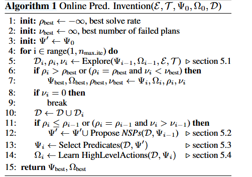

#神经符号谓词 #学术论文 
## 背景与目的
### 研究背景

机器人在现实环境中执行任务时，通常需要经历感知、理解、规划和执行几个步骤。这里有一个关键问题：**机器人不能只知道眼前图像里有什么，还需要知道当前状态意味着什么，以及执行一个动作后，环境可能发生什么变化。**

### 现有方法面临问题
#### 1. 直接使用原始视觉信息进行规划比较困难

机器人摄像头获得的通常是图像、像素、物体位置等低层信息。

但是，传统符号规划器更习惯处理清晰的逻辑条件，例如：

- `Clear(A)`：A 上方没有其他物体。
    
- `Holding(A)`：机器人正拿着 A。
    
- `On(A,B)`：A 位于 B 上。
    

因此，需要将复杂的视觉信息转换为规划器能够使用的抽象状态。

#### 2. 人工设计谓词和动作模型成本较高

传统符号规划通常需要提前定义谓词、动作的前置条件以及动作效果。

#### 3. 规划模型可能与真实环境不一致

这是论文特别关注的问题。

假设机器人认为，只要积木 A 没有被压住，就一定能够抓取它。但在真实执行时，抓取技能可能失败。

这意味着：规划器认为动作可以执行，不代表机器人在真实环境中一定能成功执行。

如果模型不能准确描述动作的适用条件和执行效果，机器人就可能反复生成无法执行的计划，或者虽然完成了动作，却没有实现最终目标。

#### 4. 如何在没有专家示范的情况下学习？

很多已有方法依赖人工规则或专家提供的示范轨迹。但在新的环境中，机器人未必能获得足够的示范数据。

因此，论文希望机器人能够从零开始，通过与环境交互、执行技能、观察结果和分析失败，逐步学习适合规划的谓词和高层动作模型。
### 本文目标

论文的核心目标，是**将神经网络的视觉理解能力与符号规划的逻辑推理能力结合起来，使机器人能够自主学习抽象世界模型。**
## 本文方法
### 问题形式化

#形式化符号及术语

- **任务T**
	 $T$是一个元组 $⟨O、 x_0、 g⟩$ ,由对象$O$、初始状态 $x0$ 和目标 $g$组成。允许的状态取决于对象 $O$,因此我们将状态空间写为 $X_O$ (当对象在上下文中明确时,也可直接写为 $X$ )。  
---

- **环境$\varepsilon$** 
	 环境是一个元组$$E=\langle U,C,f,\Lambda\rangle$$
	
	 $U$:其中 $U\subseteq \mathbb{R}^m$是机器人能够执行的底层控制指令的集合。
	 
	 ${R}^m$：表示一个由 \(m\) 个实数构成的向量空间。
	 
	 **简单理解：$U$ 规定机器人在底层能够发出哪些控制指令。**
	 
	 **$C$** ：包含用于执行底层技能的控制器，例如抓取（pick）和放置（place）。
	 **简单理解：$C$ 规定机器人有哪些可供调用的低层技能控制器。**
	
	 **$f ：X × U → X$** ：状态转移函数，**描述当前状态执行一个低层动作后，状态如何变化。**
	
	 $X$：状态空间，即所有可能状态构成的集合。
	
	 $\Lambda$ ：是一个物体类型集合，其中的类型是**物体分类器可能输出的结果。**
	 
	 技能集合 $C$ 和物体集合 $O$ 共同形成一个动作空间 $A_O$。如果上下文明确，也可以直接写成 $A$。
	 
	 把技能与物体绑定，就可以形成具体的动作实例，例如：
	
	 $\operatorname{Pick}(A)$
	 
	 表示抓取物体 A。
---
 
- **谓词$\psi$**
	 谓词 $\psi$ 是状态的一个布尔特征，并且可以通过该状态中的具体物体作为参数。
	 
	 $ψ :\mathcal{O}^m → (X → B)$
	
	|符号|含义|
	|---|---|
	|$O$|环境中的物体集合|
	|$O^m$|由 $m$ 个物体组成的有序组合集合|
	|$X$|所有可能的环境状态构成的集合|
	|$\mathbb{B}$|布尔值集合，即 Ture和False|
	|$\psi$|谓词|
	 
	 **谓词本质上是一个用于判断某个条件是否成立的函数。**

---
- **高层动作** $\omega: O^m \rightarrow \langle \pi,\mathrm{PRE},\mathrm{EFF}^+,\mathrm{EFF}^- \rangle$
	
	$\omega$：高层动作。
    
    $O$：环境中的物体集合。
    
	$O^m$：由 $m$个物体组成的有序参数组合。
    
	$\pi$：实际执行的低层技能。
    
    $\mathrm{PRE}$：前置条件。
    
	$\mathrm{EFF}^+$：需要加入抽象状态的谓词。
    
	$\mathrm{EFF}^-$：需要从抽象状态中删除的谓词。
	
	**高层动作主要解释了满足什么条件时可以执行动作，以及执行后哪些关系会发生变化？**
---

- **抽象状态转移函数 $F : S ×Ω_O → S$**为
	$$
			F(s, =\langle \pi, \text{PRE}, \text{EFF}^+, \text{EFF}^- \rangle) = 
				\begin{cases} 
				(s \cup \text{EFF}^+ )\setminus \text{EFF}^- & \text{， } \text{PRE} \subseteq s \\ 
				\text{undefined，} & \text{otherwise} 
				\end{cases} \quad 
				$$
	**输入当前抽象状态和一个高层动作，模型就可以预测动作执行后对应的抽象状态。**
	  
	**如果：**
	
	$\mathrm{PRE}\subseteq s$ 
	
	就表示动作要求成立的所有谓词，都包含在当前抽象状态 \(s\) 中。
	
	此时，新的抽象状态为：
	
	 $s'=(s\cup \mathrm{EFF}^+)\setminus \mathrm{EFF}^-$ 
	
	这个计算分成两个操作。
	
	- $s\cup \mathrm{EFF}^+$：把正效果中的谓词加入当前状态。
	    
	- $(s\cup \mathrm{EFF}^+)\setminus \mathrm{EFF}^-$：再把负效果中的谓词删除。 
	
	**否则：**
	  
	前置条件不满足undefined 的意思是：这个动作在当前抽象状态下没有定义的合法状态转移。
	

---
- **低层计划**：
	 低层计划是一个由 $n$ 个技能组成的序列，每个技能都作用于相应的物体。可以写成：
 $$ (\pi_1,\pi_2,\ldots,\pi_n)\in A_O^n$$
	 低层计划关注的是**具体调用哪些技能，以及按什么顺序调用。** 
 
	如果从初始状态 $x_0$开始，依次执行这些技能，最终满足目标 $g$，那么这个低层计划就解决了该任务。
---
- **高层计划**
	高层计划是一个由 \(n\) 个高层动作组成的序列，每个高层动作都作用于相应的物体。可以表示为：

	$$(\omega_1,\omega_2,\ldots,\omega_n)$$
	**高层规划器可以根据 HLA 的前置条件和状态转移模型，判断这些动作是否能够依次执行，以及最终是否满足任务目标。**
---
**高层计划：关注任务逻辑**，知道执行低层动作，并且知道这会改变哪些符号关系。  
  
**低层计划：关注技能执行**，实际调用/低层控制技能。

---
### **神经符号谓词**（Neuro-Symbolic Predicates，NSP）
#谓词 #神经符号
神经符号谓词表示一种具有视觉依据、同时具备丰富逻辑表达能力的抽象形式，可以支持高效的规划和问题求解。

NSP 的关键思想是：

**用神经网络处理难以手工编写规则的感知问题，用程序和逻辑处理适合明确计算的关系问题。**

### NSP又分为**原始谓词**何**派生谓词**

- **原始谓词Primitive NSPs：**
	 - 输入：图像、传感器数据、物体姿态等。
    
	-  方法：调用 VLM 或读取机器人本体状态。
    
	-  输出：某个基础事实是否成立。

- **派生谓词Derived NSPs：**
	- 输入：已有谓词的真假值。
    
	- 方法：逻辑运算、循环、递归等。
    
	-  输出：更复杂关系的真假值。

**原始谓词利用python API对原始状态计算，直接观察环境，派生谓词利用已有的判断结果进行逻辑推理。**

为了提高 VLM 判断准确率，用了两个技巧：

1. 给 VLM 看「上一帧图像 + 刚执行过的动作」消歧；
2. 在画面上给每个物体标唯一 ID，避免“哪个 block”分不清。
### 分层规划

有了抽象世界模型，接下来就是让机器在该抽象世界模型中进行执行，首先**利用抽象世界模型制定高层规划(高层动作序列)**,然后通过为每个高层动作**调用相应的技能策略来生成底层动作序列。**

高层规划利用快速符号规划器使用自动推导的启发式**$A^*$搜索**

---

- **符号规划器**
	 符号规划器根据形式化的状态、动作和目标进行搜索。
	
	 规划器使用的核心信息包括：

	- 当前抽象状态；
    
	- HLA 的前置条件；
    
	- HLA 的正效果和负效果；
    
	- 任务目标。
	
	规划器可以判断：
	
	如果当前状态满足 `Clear(A)`，那么 `PlaceOnTable(A,T,B)` 就符合该 HLA 的执行条件；执行后，抽象状态会发生相应变化。
	
	规划器可以根据这些规则搜索动作序列，而不需要每探索一个动作都在真实机器人上试一遍。
---
- **$A^*$搜索**
	A* 是一种常见的图搜索算法。它利用已经付出的代价和对剩余代价的估计，决定优先探索哪些节点。

	其评价函数通常写为：

	**$f(n)=g(n)+h(n)$** 

其中：
- **$g(n)$：从初始节点到当前节点 \(n\) 的实际累计代价。**  
- **$h(n)$：从当前节点到目标节点的剩余代价估计。** 
- **$f(n)$：用于确定搜索优先级的评价值。**
---
分层规划可能以以下两种方式之一失败:

- **规划失败#1：** 不可行，如果高层计划中的某个技能无法成功执行，那么这个高层计划就是不可执行的。

- **规划失败#2：** 如果高层计划中的技能都成功执行了，但最终仍然没有实现目标，那么该计划就是未满足目标的计划。
---

### 发明谓词算法
#算法

学习器（learner）需要以下几个输入：

| 符号           | 含义                     | 直观理解           |
| ------------ | ---------------------- | -------------- |
| $\mathcal E$ | 环境（Environment）        | 机器人实际操作的环境     |
| $\mathcal T$ | 训练任务集合（Training Tasks） | 机器人需要尝试完成的一组任务 |
| $\Psi_0$     | 初始谓词集合                 | 一开始已经拥有的谓词     |
| $\Omega_0$   | 初始 HLA 集合              | 一开始已有的高层动作模型   |
| $\mathcal D$ | 初始数据集                  | 过去交互得到的数据；通常为空 |

论文用两个指标追踪学习进度：

- **$\rho_{\text{best}}$：目前为止最高的训练任务成功率（training solve rate）。**
    
- **$v_{\text{best}}$：目前为止最少的不可行计划数量（number of infeasible plans）。**

**算法核心思想：**

	输入初始模型

	环境、训练任务、初始谓词、初始 HLA、已有数据

	① 使用当前模型执行任务

	得到新数据、成功率和不可行计划数

	② 更新历史最佳模型

	成功率更高，或成功率相同但不可行计划更少，就保存

	③ 累积数据，必要时提出新谓词

	当本轮表现比上一轮差时，触发 NSP 候选生成

	④ 选择谓词并学习高层动作

	形成下一轮要测试的抽象世界模型

	⑤ 重复或提前停止

	达到迭代上限或满足算法中的提前停止条件后，返回历史最佳模型
---
### 提出谓词

- **策略 #1(判别)**
	
	有助于发现适合作为技能前置条件的谓词。我们向视觉语言模型提供技能成功和失败的示例状态,并要求其生成预测技能何时可适用的代码。

- **策略 #2(转移建模)**
	
	有助于发现对后置条件有用的谓词。我们向视觉语言模型提供成功执行技能前后的快照,并要求其生成描述(分别在)之前或之后发生变化的属性的代码。

- **策略 #3(无条件生成）**
	
	提示视觉语言模型提出新谓词,作为现有谓词(无论是内置的还是 先前提出的)的逻辑扩展,而不以原始规划数据为条件。这种方法有助于创建派生谓词。
---
### 选择谓词集

VLM生成的谓词通常精确率较低或者会导致少量数据过拟合。

论文采用了**分类准确率**评价及**简单性偏好**来筛选谓词。

首先通过使用目标谓语学习高层动作，再评估这些高层动作的以分类准确率。**（根据抽象状态及相关信息，判断某个技能是否适用，或对技能执行结果进行相应的预测。）**

但若只追求分类准确率，可能回不断添加谓词，让模型越来越复杂。

但在数据很少时，复杂模型容易记住已有数据中的偶然规律。

因此在目标函数中加入简单性偏好，鼓励使用更简单的谓词集合。

最后采用贪婪最佳优先搜索(GBFS)搜索出一组最适合当前规划任务的谓词。

 **贪婪最佳优先搜索(GBFS)**：搜索会优先考虑当前评分看起来更好的候选集合，而不是毫无区别地逐一扩展所有可能性。
 
 ---
 
### 学习高层动作

文中改进了聚类与交集算子学习算法来进行高层动作学习，改进其前置条件学习器,以实现更高效的探索和更好的泛化。

- **Cluster（聚类）**：将交互数据中具有相似抽象转移特征的样本归类。
    
- **Intersect（求交）**：利用相关样本共有的条件，推断动作可能需要满足的前置条件。

每条转移数据恰好由一个高层动作建模,

最小化 HLA 的语法复杂度(**在满足数据建模要求的情况下，尽量让高层动作的描述简单**)
